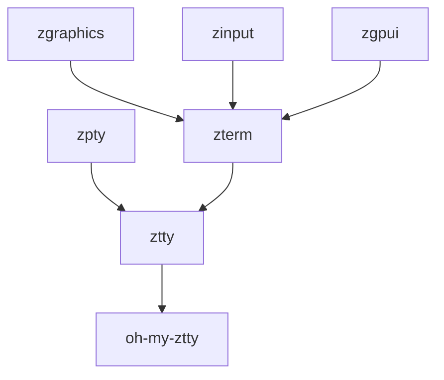

# Project Z

Project Z 把独立库和实际消费者固定在一组可以一起验证的源码提交上。各仓库继续维护自己的实现、许可证和发布流程；本仓库负责回答三个问题：**改了哪个库、会影响谁、这次测试实际使用了哪份代码。**

[项目与依赖索引](docs/PROJECTS.md) 列出每个仓库的角色、实际包名、版本、直接关联和固定源码；它与 `catalog.json` 一起由 Cargo 工作区信息生成。`.gitmodules` 保存仓库来源，`project-z.toml` 声明消费者角色和特殊 manifest 位置。新增项目进入这些清单后，版本检查、本地依赖覆盖和下游影响分析一并生效。

## 开始联调

需要 Git、Python 3.11 或更新版本，以及 `rust-toolchain.toml` 固定的 Rust 1.100.0。不同应用仍可能需要自己的系统开发库和外部服务。

```sh
git clone --recurse-submodules https://github.com/LIghtJUNction/project-z.git
cd project-z
python3 scripts/project_z.py check
python3 scripts/project_z.py resolve --all
```

`check` 核对版本约束、依赖环、退役包名、源码归属和生成文件。`resolve` 进一步调用 Cargo，确认选中的 Project Z 依赖确实来自本次检出的源码；`--all` 包含应用在内的所有 Rust 工作区。只有版本号一致还不够：同名同版本的旧注册表包，不能冒充正在修改的本地库。

运行指定消费者，或者运行某个库的所有 Rust 下游：

```sh
python3 scripts/project_z.py run --repo zcall -- test --lib --tests
python3 scripts/project_z.py impact zconv
python3 scripts/project_z.py impact --repositories zconv
python3 scripts/project_z.py run --affected zconv -- check
```

不指定 `--repo` 或 `--affected` 时，`run` 和 `resolve` 默认选择角色为 `library` 的仓库。应用、绑定、安装套件和兼容层可单独选择；需要数据库、设备或桌面会话的应用验收继续按其自身文档执行。`impact` 默认输出 Cargo package 的传递下游；加 `--repositories` 会同时包含政策清单中 `requires` 声明的运行时服务和安装套件。`run --affected` 会验证这些下游中的 Rust 工作区，非 Rust 安装验收仍按对应项目执行。

协调脚本临时创建根目录 `.cargo/config.toml`，让测试内部启动的 Cargo 进程使用相同覆盖；结束时清理自己创建且未被改动的文件。已有不同配置会明确报错，不会覆盖。Cargo 的版本约束、feature、目标平台和 `--locked` / `--offline` / `--frozen` 语义仍然有效。协调器在解析与验证完成后，恢复各工作区锁文件调用前的内容、权限和存在性，避免本地 patch 把发布用锁文件留在修改状态；已有用户改动仍会保留。请在独立检出中联调，不要让其他 Cargo 作业同时改写同一锁文件。

## 库与消费者的分工

| 领域 | 主要项目 | 共享边界 |
| --- | --- | --- |
| 编码与文本 | `z58`、`z64`、`zhex`、`zmime`、`zscan` | 字节和格式转换，不承担应用权限 |
| 协议与调用 | `zconv`、`zcall`、`zmcpio`、`zdwire`、`zldap` | 协议状态、事件转换和调用契约 |
| 执行与扩展 | `zharness`、`zplugin` | 工具执行、插件 ABI 和插件生命周期 |
| 系统接口 | `zsys` | 可以复用的平台能力；原生动态库加载已集中在 `dylib` feature |
| 进程与终端 | `zpty`、`zvte`、`zterm`、`ztuio` | 伪终端与子进程、协议解析、屏幕状态、行与帧差分分别维护 |
| 图像与界面 | `zgraphics`、`zgpui`、`zui` | 图像协议和解码、可移植场景布局、原生窗口与控件分别维护 |
| 输入与输入法 | `zinput`、`ztype` | 有界组合输入、候选与插件契约由框架维护，词库、候选界面和文本送达由应用负责 |
| 应用与集成 | `ssmcp`、`zuse`、`ztty`、`zcalld`、`zcall-gui`、`zmcl`、LMM API | 消费公共库，保留应用状态与业务策略 |
| 实际外部消费者 | OniMods 的 `onim`、`mechrevo-drivers` 控制台 | 从实际 Cargo manifest 跟踪 `zhex` 与 `zclap` 的传播 |
| 命令与安装 | `zclap`、`zclick`、`zshard`、`zdot`、`zrc`、`zfetch`、`oh-my-ztty` | 参数解析、绑定、shell、配置和安装集成 |
| 打包与桌面入口 | `zdistro`、`zcall-omarchy` | 发行格式生成、已有网关的桌面入口；按实际制品和运行环境验收 |
| 可选兼容 | `zcalld-compat` | 独立兼容层，其依赖和许可证单独管理 |

纯计算核心无需为“统一”而增加系统依赖。需要相同系统能力的消费者通过 `zsys` 复用实现；协议处理、窗口路由和应用策略仍由其所属库维护。`zplugin` 的原生加载经 `zsys::dylib` 提供，Wasm 可选依赖保持独立。此边界不代表所有应用的每一个操作系统调用都已迁移。

LMM API 作为真实消费者纳入清单，其 Rust Core 和 CLI 分别读取自己的 manifest。已有的 `zconv`、`zclap`、`zhex` 依赖参与影响分析；身份、资金、权限与生产部署继续由 LMM API 维护。

## 终端与原生界面的边界

这些库分别处理不同的输入和输出，宿主把它们组合成应用：

| 项目 | 输入与职责 | 交给宿主的输出 |
| --- | --- | --- |
| `zpty` | 管理 Linux/macOS PTY、Windows ConPTY 和直属子进程；非阻塞读写 | 进程字节流、就绪句柄与退出状态 |
| `zterm` | 解释字节流，维护字符单元、光标、滚动历史与输入模式 | 屏幕状态、协议响应及可选使用的场景数据 |
| `zgraphics` | Kitty/Sixel 图像协议、有界解码、存储和放置 | RGBA 缓冲和绘制矩形 |
| `zgpui` | `no_std` 场景、布局和渲染契约 | 可由宿主渲染器执行的场景 |
| `zui-native`（仓库 `zui`） | 标准库与原生平台桥接的窗口、事件、OpenGL 和控件 | 可运行的原生界面 |
| `ztty` | 组合进程、终端状态、字体、窗口与剪贴板策略 | 用户使用的终端应用 |

`zpty`、`zgraphics` 和 `zterm` 均使用 `no_std + alloc`。`zpty` 当前没有 Cargo 依赖；`zgraphics` 使用 Zune 解码库。`zterm` 通过常规 Cargo 依赖组合 `zvte`、`zinput`、`zgraphics` 和 `zgpui`，场景是否启用由宿主在运行时决定。

`zui-native` 与 `zgpui` 当前拥有不同 API 和平台职责，现有消费者按实际接口固定来源。未来统一公共入口时，需要先落地接口迁移并验证窗口、输入和渲染，再同步消费者的包名与源码。

以下箭头表示上游变更需要传播到的消费者。完整关系由[项目索引](docs/PROJECTS.md)和 `impact --repositories` 给出：



运行时和源码分发关系也参与传播：`zrc` 使用 `zdot` 与可选的 SSMCP 集成，`oh-my-ztty` 固定六个组件，`zcall-omarchy` 调用 zcalld 的管理 CLI 并提供可选兼容功能入口。`requires` 用于这种关系的影响分析，包括可选功能；实际安装依赖和 Cargo 构建仍以所属项目的 manifest 为准。

## 新增库或更新依赖

先在所属仓库实现并验证变更，再固定消费者与聚合仓库的提交：

```sh
git submodule add -b main https://github.com/OWNER/PROJECT.git PROJECT
# 有非根 Cargo.toml 或非 library 角色时，编辑 project-z.toml。
python3 scripts/project_z.py sync
python3 scripts/project_z.py check
python3 scripts/project_z.py resolve PROJECT
python3 scripts/project_z.py impact PROJECT
```

`sync` 只重建目录清单、项目索引和所有可发布 package 的本地 patch，不拉取远端、不修改依赖版本，也不把不兼容的组合变成兼容。仓库名、package 名、Rust 导入名和目录名可以不同；以 Cargo 的实际工作区成员为准，不根据名字以 `z` 开头来推断归属。

消费者可以持有独立库的嵌套子模块。只有提交、包在仓库中的相对位置和干净源码均一致时，协调器才接受它与根目录 canonical 副本等价。复制代码后保留同一版本号无法通过这项检查。

**传播原则：底层库的负责人负责升级所有受影响的直接与间接下游。** 更新清单应包含库、应用、运行时服务和安装套件；通过 `impact --repositories` 枚举，再与现有维护者确认范围。完成标准是适配、依赖与锁文件更新、相应验证和远端提交都已落实，或明确记录尚未解除的阻碍及接手人。底层发布和通知本身不代表传播完成。

发布顺序可由依赖图计算：

```sh
python3 scripts/project_z.py order
python3 scripts/project_z.py graph --format mermaid
```

按底层库、直接消费者、上层应用的顺序验证与发布。上游版本能从注册表获取之后，再提交消费者的精确版本更新。先推送子仓库，再更新本仓库 gitlink、运行 `sync` 和检查，最后提交兼容快照。执行 `git submodule update --remote` 前检查目标工作区，避免改变其他会话正在使用的检出。

## 本地验证与正式发布

日常开发、修复和合并以本地验证为准，不自动触发 push/PR 持续集成，也不依赖重复远端检查等待。合入快照前，本地检查协调器、真实依赖图、生成清单、全部工作区的解析和受影响公共库；保留可复核的源码与结果。

正式发行需要的跨平台构建、签名、制品和部署流水线继续保留。协调工作流只提供手动和可复用入口，按发行需要在 Linux、Windows、macOS 上运行检查。各库自身的 ABI、设备、GUI、资源边界和发布验证继续保留；交叉编译、原生测试和真实设备验收分别报告。

GitHub Actions 的 **Release Project Z** 先调用统一验证，再打包当前固定的递归子模块。默认上传源码包与 `commits.txt`，打开 `publish` 才创建 GitHub Release。聚合版本与各库自己的版本分开：聚合标签表示一组经过协调的源码提交，不替代 crates.io 或其他包注册表的发布。

```sh
python3 scripts/release.py patch dist
```

本地打包要求依赖检查通过、受跟踪文件干净、递归子模块与记录提交一致。版本按现有 `vMAJOR.MINOR.PATCH` 标签递增，首次 `patch` 为 `v0.0.1`。源代码包保留各项目的原始许可证。协同修改规则见 [CONTRIBUTING.md](CONTRIBUTING.md)。

## 定时维护

运行 `python3 scripts/maintenance.py` 检查上游提交、注册表版本和待审查的新仓库，输出 JSON 与 Markdown。显式 `--apply` 在独立工作树中更新已知 gitlink，通过依赖检查后形成候选提交。每日 GitHub 审计与定时维护代理的职责、验证范围见 [自动维护说明](docs/automation.md)。
